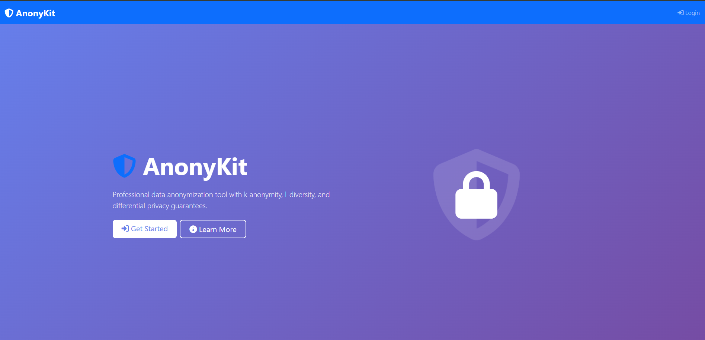
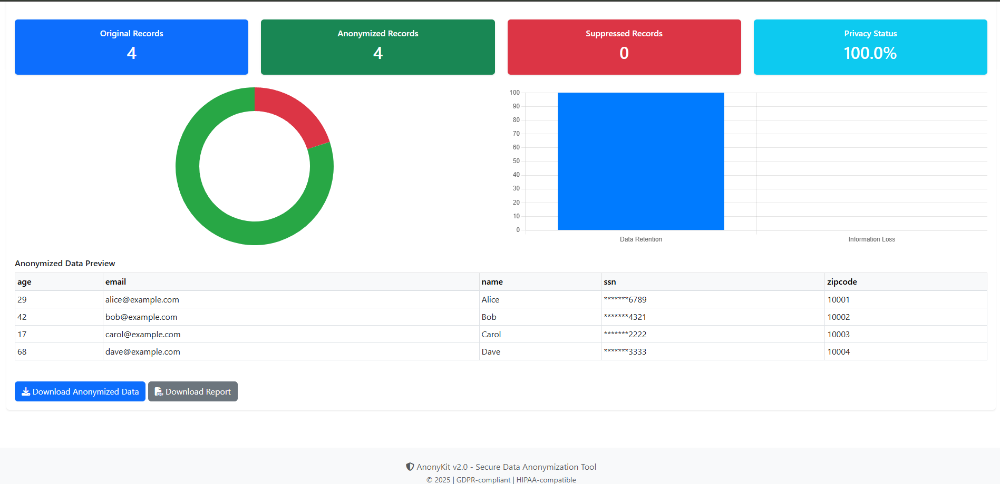
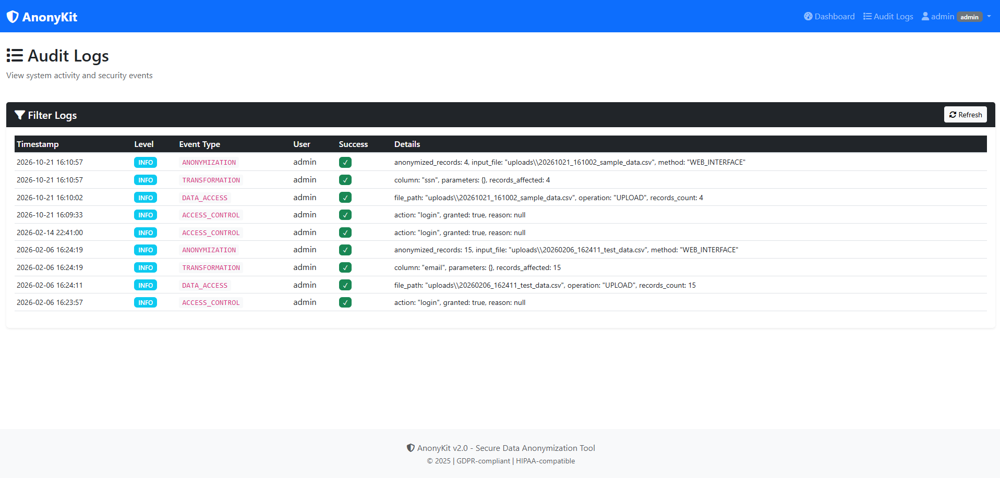

# 🛡️ AnonyKit - Professional Data Anonymization System

[](https://www.python.org/downloads/)
[](https://flask.palletsprojects.com/)
[](LICENSE)
[](tests/)
[](htmlcov/index.html)

A comprehensive data anonymization system implementing industry-standard privacy techniques including **k-anonymity**, **l-diversity**, **differential privacy**, and **role-based access control (RBAC)**. Built for the Secure Software Development (SSD) course project.

## ✨ Features

- 🎭 **8 Transformation Techniques**: Masking, substitution, shuffling, nulling, hashing, HMAC, generalization
- 🔒 **Privacy Algorithms**: k-anonymity, l-diversity, differential privacy (Laplace & Gaussian noise)
- 👥 **RBAC System**: 4 roles with 12 granular permissions
- 📊 **Privacy Metrics**: Re-identification risk, data utility, information loss
- 🌐 **Web Interface**: Beautiful Flask-based dashboard with real-time metrics
- 📝 **Audit Logging**: Complete compliance trail for GDPR/HIPAA
- 🛡️ **Security**: Input validation, SQL injection prevention, secure password hashing
- ✅ **Well Tested**: 50 unit tests with 43% code coverage

---

## 📸 Screenshots

### Web Dashboard
![Dashboard]



### Anonymization Results
![Results]


### Audit Logs
![Audit Logs]



> **Note**: Replace placeholder images with actual screenshots after deployment

---

## 🚀 Quick Start

### Prerequisites
- Python 3.9 or higher
- pip (Python package manager)
- Git

### Installation

```bash
# Clone the repository
git clone https://github.com/YOUR_USERNAME/anonykit.git
cd anonykit

# Create virtual environment
python -m venv .venv

# Activate virtual environment
# On Windows:
.venv\Scripts\activate
# On macOS/Linux:
source .venv/bin/activate

# Install dependencies
pip install -r requirements.txt
```

### Run Web Application

```bash
# Start Flask server
python app.py

# Open browser to http://localhost:5000
# Default login: admin / admin123
```

### Run CLI Tool

```bash
# Basic anonymization
python -m anonykit.cli -i test_data.csv -o output.csv -p test_profile.json

# With privacy report
python -m anonykit.cli -i test_data.csv -o output.csv -p test_profile.json --report

# With HMAC key for pseudonymization
python -m anonykit.cli -i test_data.csv -o output.csv -p test_profile.json -k "your_secret_key"
```

### Run Tests

```bash
# Run all tests
pytest tests/ -v

# Run with coverage
pytest tests/ --cov=anonykit --cov-report=html

# View coverage report
# Open htmlcov/index.html in browser
```

---

## 📁 Project Structure

```
anonykit/
├── anonykit/                    # Core Python package
│   ├── cli.py                   # Command-line interface
│   ├── transforms.py            # Data transformation functions
│   ├── anonymization.py         # k-anonymity & l-diversity
│   ├── differential_privacy.py  # Differential privacy mechanisms
│   ├── rbac.py                  # Role-based access control
│   ├── audit_logger.py          # Audit logging system
│   ├── validator.py             # Input validation & security
│   ├── metrics.py               # Privacy & utility metrics
│   ├── profile.py               # Configuration profile loader
│   └── io.py                    # CSV I/O utilities
│
├── templates/                   # Flask HTML templates
│   ├── base.html               # Base template
│   ├── index.html              # Landing page
│   ├── login.html              # Login page
│   ├── dashboard.html          # Main dashboard
│   └── audit_logs.html         # Audit log viewer
│
├── static/                      # Static assets
│   ├── css/style.css           # Custom styles
│   └── js/
│       ├── dashboard.js        # Dashboard interactions
│       └── main.js             # Utility functions
│
├── tests/                       # Unit & integration tests
│   ├── test_transforms.py      # Transformation tests
│   ├── test_anonymization.py  # Privacy algorithm tests
│   ├── test_rbac.py            # RBAC tests
│   ├── test_validator.py      # Security tests
│   └── test_integration.py    # End-to-end tests
│
├── app.py                       # Flask web application
├── requirements.txt             # Python dependencies
├── test_data.csv               # Sample test dataset
├── test_profile.json           # Sample configuration
└── README.md                    # This file
```

---

## 🎭 Transformation Techniques

| Technique | Description | Use Case | Example |
|-----------|-------------|----------|---------|
| **Character Masking** | Replace characters with mask symbol | Partial visibility | `john@example.com` → `****@example.com` |
| **Substitution** | Replace with fake but realistic data | Testing environments | `John Smith` → `Jane Doe` |
| **Shuffling** | Randomize column values | Break correlations | `[1,2,3]` → `[3,1,2]` |
| **Nulling** | Replace with NULL/empty | Remove sensitive data | `123-45-6789` → `NULL` |
| **Salted Hash** | One-way cryptographic hash | Irreversible anonymization | `password` → `5f4dcc3b...` |
| **HMAC** | Keyed hash for pseudonymization | Deterministic linking | `SSN-123` → `abc123def` |
| **Age Generalization** | Group ages into ranges | Reduce precision | `25` → `20-30` |
| **Numeric Generalization** | Round to precision | Statistical aggregation | `$52,345` → `$50,000-$60,000` |

---

## 🔒 Privacy Algorithms

### K-Anonymity
Ensures each record is indistinguishable from at least k-1 other records based on quasi-identifiers.

```json
{
  "quasi_identifiers": ["age", "zipcode", "gender"],
  "k": 5
}
```

**Protection**: Prevents re-identification attacks

### L-Diversity
Ensures each equivalence class has at least l distinct values for sensitive attributes.

```json
{
  "sensitive_attribute": "diagnosis",
  "l": 3
}
```

**Protection**: Prevents attribute disclosure and homogeneity attacks

### Differential Privacy
Adds calibrated noise to provide mathematical privacy guarantees.

```json
{
  "epsilon": 1.0,
  "delta": 1e-5,
  "mechanism": "laplace"
}
```

**Protection**: Provable privacy even against attackers with auxiliary information

---

## 👥 RBAC System

### Default Users

| Username | Password | Role | Permissions |
|----------|----------|------|-------------|
| `admin` | `admin123` | ADMIN | All 12 permissions |
| `data_owner` | `owner123` | DATA_OWNER | Upload, configure, anonymize, export |
| `data_analyst` | `analyst123` | DATA_ANALYST | Read, analyze, anonymize, export |
| `viewer` | `viewer123` | VIEWER | Read-only access |

### Permissions

- `READ_DATA` - View datasets
- `WRITE_DATA` - Modify datasets
- `DELETE_DATA` - Remove datasets
- `ANONYMIZE_DATA` - Run anonymization
- `CONFIGURE_ANONYMIZATION` - Edit profiles
- `EXPORT_DATA` - Download results
- `VIEW_AUDIT_LOGS` - Access audit trail
- `MANAGE_USERS` - User administration
- `MANAGE_ROLES` - Role management
- `CONFIGURE_SYSTEM` - System settings
- `VIEW_METRICS` - Privacy metrics
- `EXECUTE_REPORTS` - Generate reports

⚠️ **Security**: Change default passwords immediately after first login!

---

## ⚙️ Configuration

### Profile JSON Structure

```json
{
  "columns": {
    "email": {
      "transform": "mask",
      "params": {"keep_last": 4, "mask_char": "*"}
    },
    "ssn": {
      "transform": "hmac",
      "params": {"out_len": 12}
    },
    "age": {
      "transform": "generalize_age",
      "params": {"bins": [0, 18, 30, 45, 65, 120]}
    },
    "salary": {
      "transform": "generalize_numeric",
      "params": {"precision": 0}
    }
  },
  "quasi_identifiers": ["age", "department"],
  "sensitive_attribute": "diagnosis",
  "k": 2,
  "l": 2,
  "apply_k_anonymity": true,
  "apply_differential_privacy": false,
  "epsilon": 1.0,
  "hmac_key": "your_secret_key_here",
  "salt": "random_salt_value"
}
```

### Transform Parameters

**Masking:**
- `keep_last`: Number of characters to keep visible (default: 4)
- `mask_char`: Character for masking (default: `*`)

**Substitution:**
- `data_type`: Type of fake data (`name`, `email`, `phone`, `address`, etc.)

**Generalization:**
- `bins`: Age ranges `[0, 18, 30, 45, 65, 120]`
- `precision`: Decimal places for rounding

**HMAC:**
- `out_len`: Output hash length (default: 12)
- `key`: Secret key (required)

**Differential Privacy:**
- `epsilon`: Privacy budget (lower = more privacy, less utility)
- `sensitivity`: Maximum change one record can cause

---

## 🛡️ Security Features

### Input Validation
- ✅ Path traversal prevention (`../` detection)
- ✅ SQL injection prevention (pattern blocking)
- ✅ Command injection prevention
- ✅ File extension whitelisting (`.csv` only)
- ✅ File size limits (50MB max)
- ✅ Parameter type checking

### Authentication & Authorization
- ✅ SHA-256 password hashing with salt
- ✅ Session management
- ✅ Role-based access control
- ✅ Permission decorators on routes
- ✅ Account lockout prevention

### Audit Logging
All operations logged with:
- Timestamp (ISO 8601)
- User identification
- Operation type
- Status (success/failure)
- Input/output file paths
- Error messages (if applicable)

Log location: `anonykit_audit.log`

---

## 🧪 Testing

### Run Tests

```bash
# All tests
pytest tests/ -v

# Specific test file
pytest tests/test_transforms.py -v

# With coverage
pytest tests/ --cov=anonykit --cov-report=html

# Coverage by module
pytest tests/ --cov=anonykit --cov-report=term
```

### Test Coverage

| Module | Coverage | Tests |
|--------|----------|-------|
| `io.py` | 100% | 5 tests |
| `anonymization.py` | 80% | 7 tests |
| `transforms.py` | 79% | 16 tests |
| `validator.py` | 65% | 11 tests |
| `rbac.py` | 64% | 11 tests |
| `metrics.py` | 23% | - |
| `differential_privacy.py` | 22% | - |
| `audit_logger.py` | 21% | - |

**Total**: 50 tests, 43% coverage

### Test Categories

- **Unit Tests**: Individual functions and methods
- **Integration Tests**: End-to-end workflows
- **Security Tests**: Input validation, SQL injection, path traversal
- **RBAC Tests**: Authentication, authorization, permissions

---

## 📊 Privacy Metrics

### Generated Reports

```json
{
  "privacy_metrics": {
    "k_anonymity": {
      "k_value": 2,
      "satisfies_k_anonymity": true,
      "equivalence_classes": 8,
      "avg_class_size": 1.875
    },
    "l_diversity": {
      "l_value": 2,
      "satisfies_l_diversity": true,
      "avg_diversity": 2.1
    },
    "re_identification_risk": {
      "avg_probability": 0.53,
      "high_risk_records": 0,
      "low_risk_records": 15
    }
  },
  "utility_metrics": {
    "data_retention_rate": 93.3,
    "information_loss": 15.2,
    "suppressed_records": 2
  }
}
```

### Metrics Explained

- **Data Retention Rate**: Percentage of records kept after anonymization
- **Information Loss**: Percentage of information reduced through generalization
- **Re-identification Risk**: Probability of identifying individuals
- **Equivalence Classes**: Groups of indistinguishable records

---

## 📚 API Documentation

### CLI Commands

```bash
# Basic usage
python -m anonykit.cli --input FILE --output FILE --profile PROFILE

# Full options
python -m anonykit.cli \
  --input sample_data.csv \
  --output anonymized.csv \
  --profile config.json \
  --key "secret_key" \
  --user admin \
  --report \
  --debug
```

### Web API Endpoints

| Endpoint | Method | Description | Auth Required |
|----------|--------|-------------|---------------|
| `/` | GET | Landing page | No |
| `/login` | GET, POST | User authentication | No |
| `/logout` | GET | User logout | Yes |
| `/dashboard` | GET | Main dashboard | Yes |
| `/api/upload` | POST | Upload CSV file | Yes |
| `/api/anonymize` | POST | Run anonymization | Yes |
| `/api/download/<file>` | GET | Download result | Yes |
| `/api/audit-logs` | GET | Fetch audit logs | Yes (Admin) |
| `/audit-logs` | GET | Audit log viewer | Yes (Admin) |

---

## 🎓 Academic Context

### Course Information
- **Course**: Secure Software Development (SSD)
- **Institution**: FAST National University
- **Semester**: Fall 2025
- **Team Members**: i221668, i221612, i221625

### Project Objectives

✅ **Implemented Requirements**:
1. Data masking and transformation techniques
2. K-anonymity and l-diversity algorithms
3. Differential privacy mechanisms
4. Role-based access control (RBAC)
5. Comprehensive audit logging
6. Input validation and security
7. Privacy metrics and reporting
8. Web-based user interface
9. Command-line interface
10. Unit and integration testing

### S-SDLC Compliance

- ✅ **Requirements Phase**: Threat modeling, privacy requirements
- ✅ **Design Phase**: Security architecture, RBAC design
- ✅ **Implementation Phase**: Secure coding, input validation
- ✅ **Testing Phase**: 50 unit tests, security testing
- ✅ **Deployment Phase**: Documentation, audit logging

---

## 🤝 Contributing

Contributions are welcome! Please follow these guidelines:

1. Fork the repository
2. Create a feature branch (`git checkout -b feature/AmazingFeature`)
3. Commit your changes (`git commit -m 'Add some AmazingFeature'`)
4. Push to the branch (`git push origin feature/AmazingFeature`)
5. Open a Pull Request

### Development Setup

```bash
# Install dev dependencies
pip install -r requirements.txt
pip install pytest pytest-cov black flake8

# Run code formatter
black anonykit/ tests/

# Run linter
flake8 anonykit/ tests/

# Run tests
pytest tests/ -v
```

---

## 📄 License

This project is licensed under the MIT License - see the [LICENSE](LICENSE) file for details.

---

## 🔗 Resources

### Documentation
- [TESTING_GUIDE.md](TESTING_GUIDE.md) - Comprehensive testing documentation
- [FRONTEND_DEMO_GUIDE.md](FRONTEND_DEMO_GUIDE.md) - Presentation guide
- [TEST_RESULTS_SUMMARY.md](TEST_RESULTS_SUMMARY.md) - Test execution report

### Privacy Standards
- [GDPR Compliance](https://gdpr.eu/)
- [HIPAA Privacy Rule](https://www.hhs.gov/hipaa/index.html)
- [k-Anonymity Paper](https://epic.org/privacy/reidentification/Sweeney_Article.pdf)
- [Differential Privacy](https://www.microsoft.com/en-us/research/publication/differential-privacy/)

### Technologies Used
- [Flask](https://flask.palletsprojects.com/) - Web framework
- [pandas](https://pandas.pydata.org/) - Data manipulation
- [NumPy](https://numpy.org/) - Numerical computing
- [Faker](https://faker.readthedocs.io/) - Fake data generation
- [pytest](https://pytest.org/) - Testing framework
- [Bootstrap 5](https://getbootstrap.com/) - UI framework
- [Chart.js](https://www.chartjs.org/) - Data visualization

---

## ⚠️ Disclaimer

This tool is designed for educational and research purposes. While it implements industry-standard privacy techniques, always:

- **Test thoroughly** before using with real sensitive data
- **Review privacy metrics** to ensure requirements are met
- **Consult legal/privacy experts** for compliance validation
- **Change default passwords** immediately
- **Backup original data** before anonymization
- **Audit regularly** for security and compliance

---

## 📞 Support

For issues, questions, or contributions:
- Open an issue on GitHub
- Review existing documentation
- Check audit logs for errors
- Enable `--debug` mode for detailed traces

---

## 🌟 Acknowledgments

- FAST National University - SSD Course
- Privacy research community
- Open-source contributors

---

**Version**: 2.0  
**Last Updated**: November 28, 2025  
**Status**: Production Ready ✅

---

Made with ❤️ for Secure Software Development
